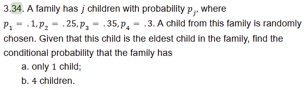
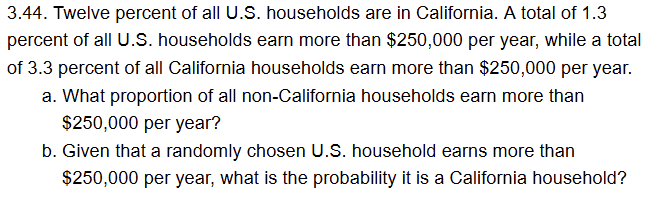
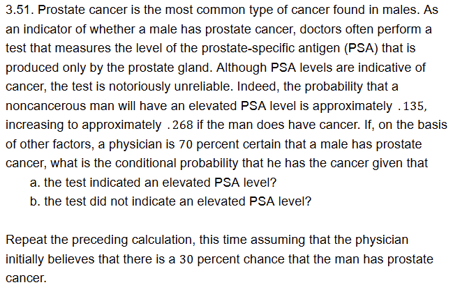
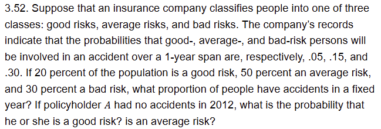

## Chapter 3
### Questions 34, 44, 51, 52, 53

### Question 34

```
Step 0. What is the question asking for?
A child is randomly chosen:

Probability that family has only 1 child given the child is eldest in the family
- P(F.1|E)

Probability that family has 4 children given the child is eldest in the family
- P(F.4|E)

Step 1. Lets review definitions:
E = child is eldest in family
F.i = family has i children (an event)
F.1 = family has 1 child
F.4 = family has 4 children
p.i = P(F.i) = probability that the family has i children

We have:
P(F.1) = p.1 = .1
P(F.2) = p.2 = .25
P(F.3) = p.3 = .35
P(F.4) = p.4 = .3

Step 2. We need P(E):
Using the law of total probability
P(E) = Summation(from i=1 to 4, P(E|F.i) * P(F.i))

Lets find P(E)
P(E) = P(E|F.1) * P(F.1) + P(E|F.2) * P(F.2) + P(E|F.3) * P(F.3) + P(E|F.4) * P(F.4)

How do we find P(E|F.1)?
P(E|F.1) = what is the probability that the child is the eldest given the family only has one child

P(E|F.1) = 1/1
P(E|F.i) = 1/i because exactly 1 of the i children is the eldest

Plug in the numbers to find P(E):
P(E) = (1/1 * 0.1) + (1/2 * .25) + (1/3 * .35) + (1/4 * .3)
P(E) = .1/1 + .25/2 + .35/3 + .3/4
P(E) = 1.2/12 + 1.5/12 + 1.4/12 + .9/12
P(E) = 5/12

Step 3. Use Bayes rule:
P(F.j|E) = (P(E|F.j) * P(F.j)) / P(E)
P(F.j|E) = (P(E|F.j) * P(F.j)) / Summation(from i=1 to 4, P(E|F.i) * P(F.i))

Now we find, given the selected child is the eldest child, what is the probability they are an only child?
P(F.1|E) = (P(E|F.1) * P(F.1)) / P(E)
P(F.1|E) = (1/1 * .1) / (5/12)
P(F.1|E) = 1/10 * 12/5 = 12/50 = 6/25

Question B:
4 Children

P(F.4|E) = (P(E|F.4) * P(F.4)) / P(E)
P(F.4|E) = (1/4 * .3) / (5/12)
P(F.4|E) = .3/4 * 12/5 = 3.6/20 = 36/200 = 9/50
```

### Question 44

```

```

### Question 51


### Question 52


### Question 53

