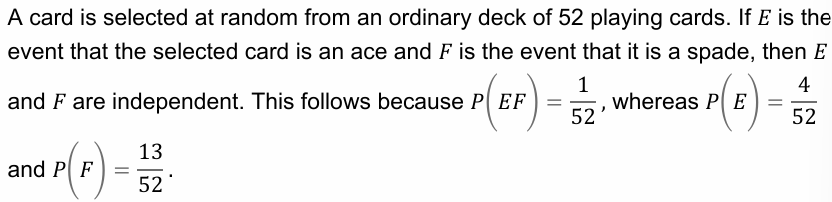
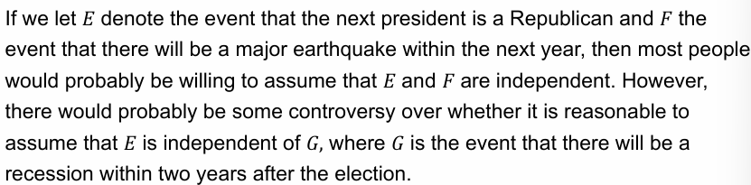

P(E | F) - conditional probability of E given F

Knowing that F occured generally changes the chances of E's occurances

This was called Dependent Events

## Independent Events
when event E is independent of F if F occured and does not change E's probability

1. P(E | F) = P(EF) / P(F), it follows that E is independent of F if P(EF) = P(E) * P(F)

Must statisfy above in order to be independent

### Example 4a


52 Playing cards

What is the probability of a selected card being an Ace?
- 4/52 since there are only 4 aces

AND (multiply)

selected card is a spade
- 13/52 since there are 13 spades in a deck of 52
```
4/52 * 13/52 = 1/13 * 13/52
13 / (13 * 52) =  1/52

and P(EF) = 1/52
```
So the probability of P(E | F) where E is event that the card is an ace and F is event that the card is a spade is independent.

### Example 4b

Two coins are flipped and all outcomes are assumed to be equally likely.
- E first coin lands on Head
- F second coin lands on Tails

Is E and F independent or dependent?

probabilities
```
S: {HH, HT, TT, TH}
E: {HT, HH} P(E) = 1/2
F: {HT, TT} P(F) = 1/2

P(E | F) = P(EF)/P(E)

If E and F are independent then this will be true:
P(EF) = P(E) * P(F)

EF: {HT} P(EF) = 1/4

Now lets check:
1/4 = 1/2 * 1/2

So E and F are independent.
```

### Example 4c
Suppose that we toss 2 fair dice. Let E.1 denote the event that the sum of the dice is 6 and F denote the event that the first die equals 4.
```
S: {1.1, 1.2, 1.3, 1.4, 1.5, 1.6, 2.1, ... , 6,6}
E.1: {5.1, 1.5, 2.4, 4.2, 3.3}
F: {4.1, 4.2, 4.3, 4.4, 4.5, 4.6}

P(S) = 1/1 = 36/36
P(E.1) = 5/36
P(F) = 6/36

P(EF) = 1/36

Now to check for independence:
P(EF) = P(E.1) * P(F)

1/36 = 5/36 * 1/6

1/36 = 5/216
So they are not independent!
```

### Example 4d



If E is independent of F then E is also independent of F-complement